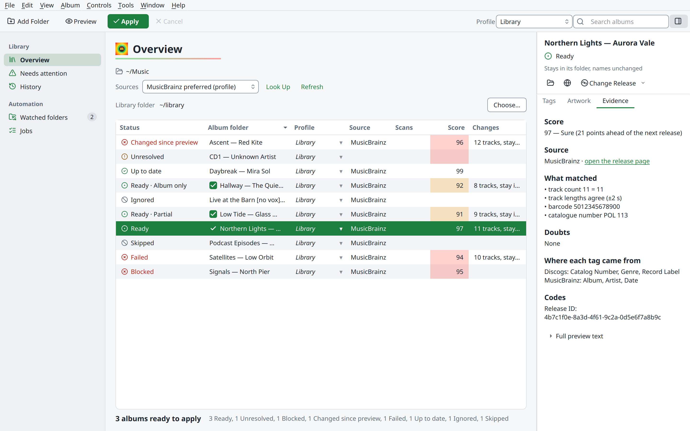
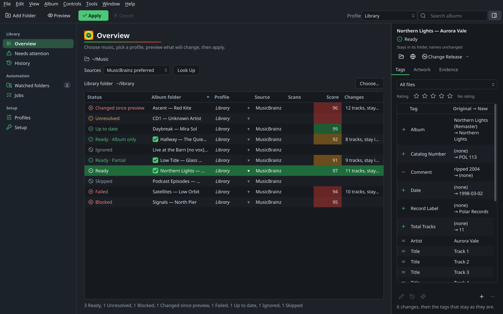
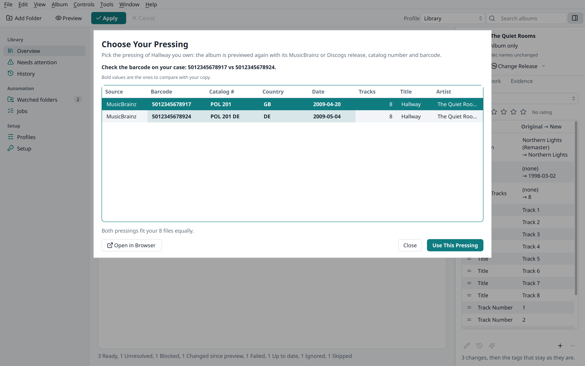
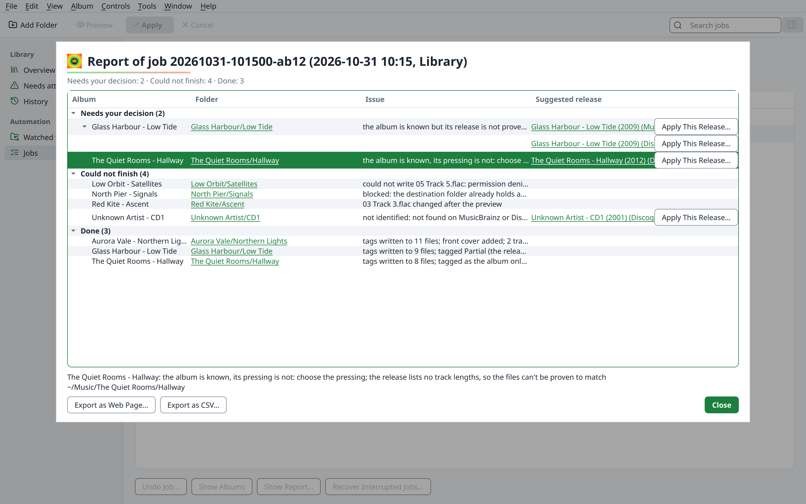
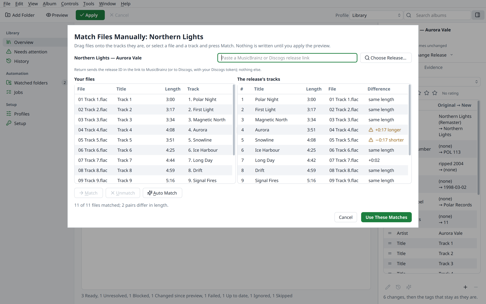
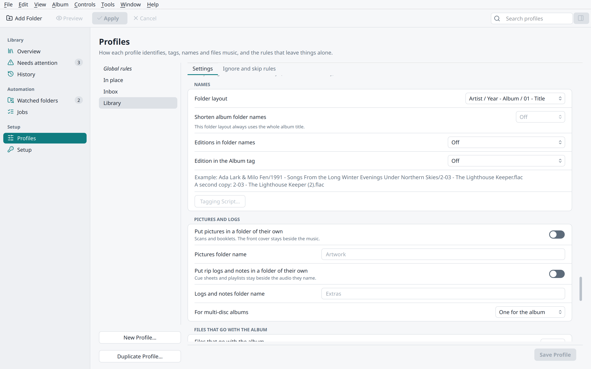
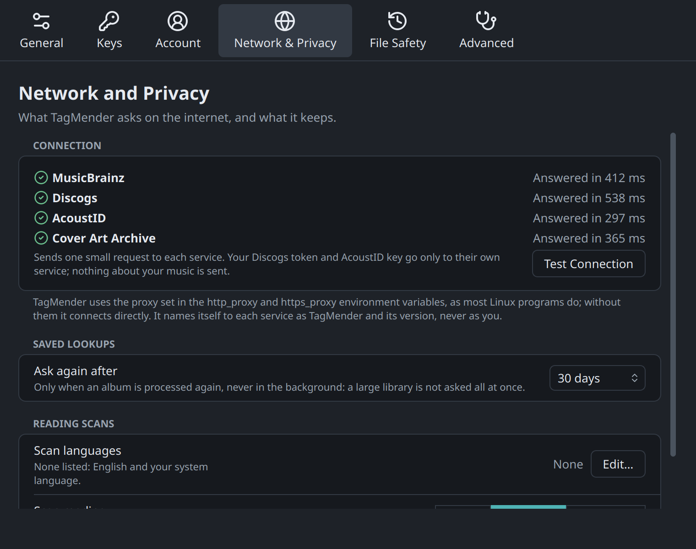

<p align="center">
  
</p>

<h1 align="center">TagMender</h1>

<p align="center">
  <b>Correct, complete tags for every album in a large music library, matched to the exact release you own.</b><br>
  MusicBrainz and Discogs as equal sources. Every change previewed, verified and undoable.
</p>

<p align="center">
  
  
  
  
  
</p>

<p align="center">
  
</p>

## The goal

Collections built over many years end up with missing, mixed or wrong tags. TagMender fixes
this without guessing. For each album it works out which release you own, down to the pressing,
from the evidence in its folder. It then writes standard tags, names and files the album, and
keeps every change undoable. When it can't prove a release, it tags only what is certain and
tells you why.

## Features

**Identify**
- Matches against MusicBrainz and Discogs using tags, file and folder names, track lengths, disc IDs
  from rip logs and cue sheets, barcodes and catalogue numbers read from your scans, and AcoustID
  fingerprints.
- Picks a release automatically only when the evidence proves it. Otherwise the album goes to review.
- Tells apart versions in one folder (a remaster and a remix, for example) and splits them into
  separate albums.

**Tag**
- Uses the MusicBrainz tag mapping, so your files read the same in other taggers, players and
  media servers.
- Three tagging levels (Basic, Enthusiast, Audiophile), Discogs details, genres, cover art,
  lyrics and ReplayGain.
- Records how sure it is in every file:

  | Tier | Marked as | What gets written |
  |---|---|---|
  | Exact release | `TAGMENDER=Resolved` | Everything your level asks for, pressing details included |
  | Album only | `TAGMENDER=Partial` | What the tied pressings share |
  | Partial | `TAGMENDER=Partial` | Artist, album, tracks and genres; never a barcode, label or release ID |
  | Unresolved | `TAGMENDER=Unresolved` | Nothing; the reason is kept and the album is retried later |

**Organise**
- Renames and moves albums with naming scripts or presets. Cover art, scans, logs and cue sheets
  move with their album.
- Keeps lossless and lossy files in separate libraries if you want, and sets duplicates aside.

**Stay safe**
- Nothing changes without a preview.
- The audio is never touched. Each write goes to a staged copy, which is checked against the
  original before it replaces anything.
- Every job can be undone, and an interrupted job is recovered.

**Work your way**
- A desktop app, a command line and watched folders that run unattended.
- Profiles hold every setting: source, target, audio formats and file operations. Presets and
  plain-language defaults are included.
- A report after every run lists what needs your decision, with a link to each album folder.
  You can export it as a web page or CSV.

**Free services, your own keys**
- Uses official free APIs: MusicBrainz, Discogs, Cover Art Archive, AcoustID, the CUETools
  database, gnudb, and the Deezer and iTunes barcode lookups.
- General web search is off by default, and no page is scraped.
- You add your own keys. They stay on your computer.

[Every feature, one by one →](docs/FEATURES.md)

## The app

A Mac-style Linux desktop app with a toolbar, a sidebar and an inspector. It has light and dark
themes, a shortcut for every command, and translations.

<table>
  <tr>
    <td width="50%"></td>
    <td width="50%"></td>
  </tr>
  <tr>
    <td><b>Inspector.</b> Every tag's old and new value. Edit, revert, add or remove tags.</td>
    <td><b>Choose your pressing.</b> Only the pressings that fit, and what to check on your copy.</td>
  </tr>
  <tr>
    <td></td>
    <td></td>
  </tr>
  <tr>
    <td><b>Run report.</b> What needs your decision, what could not finish, and what was done.</td>
    <td><b>Match by hand.</b> Drag your files onto the release's tracks.</td>
  </tr>
  <tr>
    <td></td>
    <td></td>
  </tr>
  <tr>
    <td><b>Profiles.</b> Plain sections, presets, a live naming example, and Restore Defaults.</td>
    <td><b>Test Connection.</b> Whether each service answers, is busy, or refuses a key.</td>
  </tr>
</table>

The app also has:
- album search and other versions of an album
- a script editor with live preview
- CD lookup
- MusicBrainz collections and ratings
- AcoustID fingerprint submission
- a built-in player

Nothing is sent to an online account until a sheet lists it, for an album you chose.

## Download

The newest build of `main`, rebuilt after every change once all tests pass:
**[Latest build →](https://github.com/herculepirate/tagmender/releases/tag/latest)**

| Package | For | Install |
|---|---|---|
| AppImage | Any Linux (x86_64) | `chmod +x TagMender-*.AppImage`, then run it |
| .deb | Debian 12+, Ubuntu 24.04+, Mint 22+ | `sudo apt install ./tagmender_*_all.deb` |
| Flatpak | Any Linux with Flatpak | `flatpak install --user TagMender.flatpak` |

## Quick start from source

```bash
git clone https://github.com/herculepirate/tagmender && cd tagmender
pip install --user mutagen Pillow fonttools PySide6-Essentials   # Debian/Ubuntu/Mint: add --break-system-packages
python3 tagmender.py setup        # add your keys
python3 tagmender.py gui          # open the app
```

On the command line (`tagmender` once installed, `python3 tagmender.py` from a clone):

```bash
tagmender plan ~/Music/Inbox              # identify and preview; changes nothing
tagmender run  ~/Music/Inbox              # preview, confirm, apply
tagmender undo JOB_ID                     # put a job back
tagmender watch                           # process watched folders unattended
tagmender doctor --connection             # check what is set up, and which services answer
```

New to it? Start with the [Quick start](docs/QUICK_START.md) (ten minutes), then [First run](docs/FIRST_RUN.md) for a careful first session.

## Keys and requirements

Nothing is bundled or shared. The app's **Setup** page, or `tagmender setup`, lists each item:
what it enables, where to get it, and whether it is set. Keys are stored in
`~/.config/tagmender/` with mode 600 and are never logged.

| For best results | Optional |
|---|---|
| Discogs token, AcoustID key, fpcalc, ffmpeg | MusicBrainz login (collections, ratings), AcoustID user key (submitting), gnudb e-mail, fanart.tv / TheAudioDB / Last.fm keys, web search (off by default), Tesseract and pyzbar (scans), python-discid (CD drive), Qt Multimedia (player) |

All the services are free. From a clone, Discogs data and artwork also need
[Discogs Enrichment](https://github.com/herculepirate/picard-discogs-enrichment) and
[CoverUp](https://github.com/herculepirate/picard-coverup). The packages include both.
Step by step: [Setup](docs/SETUP.md).

**Building the packages yourself:** `packaging/` builds the .deb, the AppImage and the
Flatpak. See [Building the packages](docs/USER_GUIDE.md#building-the-packages).

## Documentation

| | |
|---|---|
| [User guide](docs/USER_GUIDE.md) | Everything in detail |
| [Setup](docs/SETUP.md) | Keys, logins and optional programs |
| [Quick start](docs/QUICK_START.md) | Install, set up, look up and apply your first album |
| [First run](docs/FIRST_RUN.md) | A safe first session |
| [Profiles and naming](docs/PROFILES.md) | Every setting and its default, levels, naming scripts |
| [Providers](docs/PROVIDERS.md) | Online services, limits and caching |
| [Formats](docs/FORMATS.md) | What each audio format supports |
| [Features](docs/FEATURES.md) | Every feature and its status |
| [Upgrading](docs/MIGRATION.md) | Coming from the 0.1 batch tools |
| [Scripting guide](docs/SCRIPTING.md) | The naming and tagging script language: every function, with recipes |
| [Release notes](docs/RELEASE_NOTES.md) · [Roadmap](docs/ROADMAP.md) | What changed, what comes next |
| [Architecture](docs/ARCHITECTURE.md) · [Translating](docs/TRANSLATING.md) | For contributors |

## Development

```bash
./run_tests.sh      # every suite; synthetic audio, never touches your settings or music
```

Follow the surrounding style: plain-language messages, small functions, the standard library first.

## Licence

GPL-2.0-or-later. Icons are from [Lucide](https://lucide.dev) (ISC), and the fonts use the SIL Open
Font License. See [THIRD_PARTY_NOTICES.md](THIRD_PARTY_NOTICES.md).
TagMender isn't affiliated with MusicBrainz, the MetaBrainz Foundation or Discogs.
