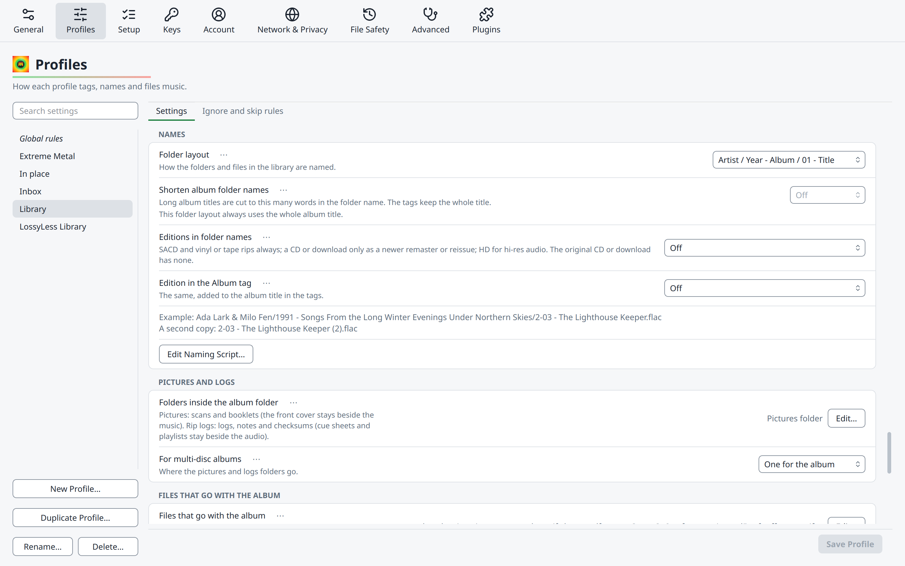
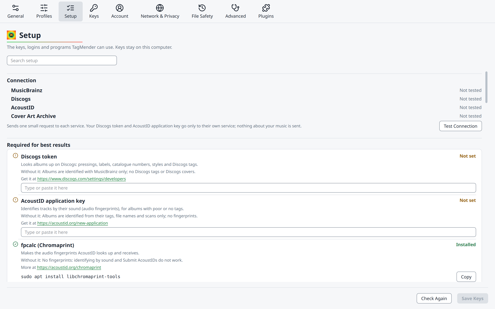
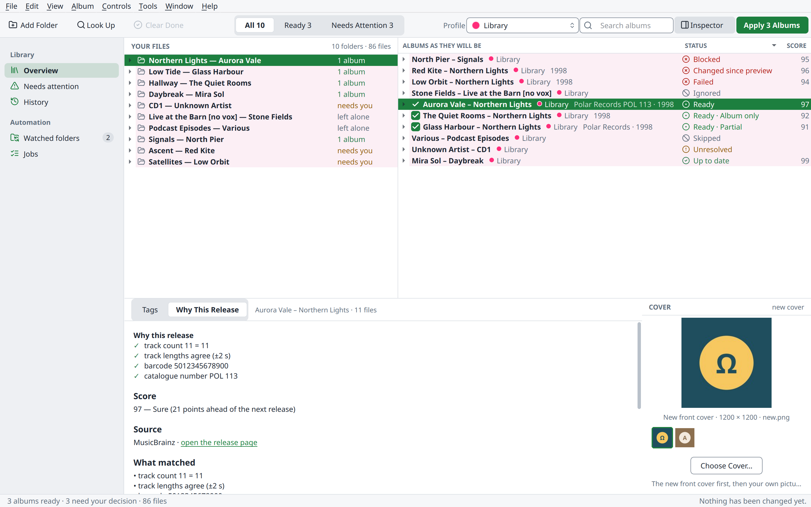
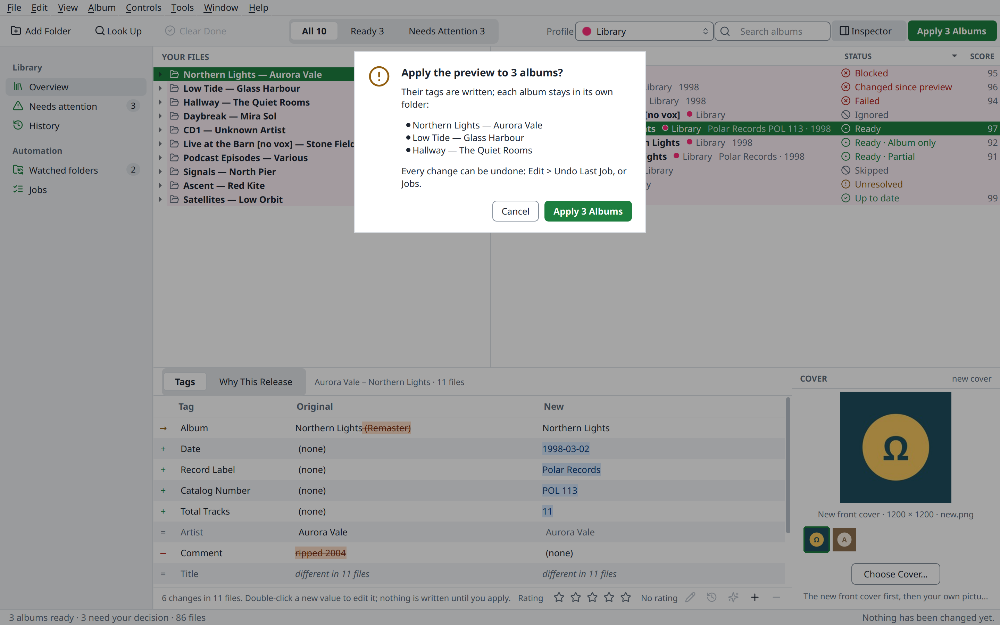

# Quick start

TagMender works out which release each of your albums is, down to the pressing. It then writes
complete tags and covers, and files the music the way you choose. **Nothing changes until you
press Apply, and every change can be undone.**

This guide takes about fifteen minutes. It starts with profiles, because a profile decides
everything TagMender does with an album.

1. [Install](#1-install)
2. [Set up your profiles](#2-set-up-your-profiles)
3. [Add your keys](#3-add-your-keys)
4. [Add music](#4-add-music)
5. [Look up and read the results](#5-look-up-and-read-the-results)
6. [Apply, then undo once](#6-apply-then-undo-once)
7. [Let it run on its own](#7-let-it-run-on-its-own)

## 1. Install

Download a package from the [latest release](https://github.com/herculepirate/tagmender/releases/tag/latest):

| Package | How to install |
|---|---|
| **AppImage** (any Linux, x86_64) | `chmod +x TagMender-*.AppImage`, then double-click it or run it |
| **.deb** (Debian 12+, Ubuntu 24.04+, Mint 22+) | `sudo apt install ./tagmender_*_all.deb` |
| **Flatpak** | `flatpak install --user TagMender.flatpak` |

These optional programs give TagMender more evidence to work from:

```bash
sudo apt install libchromaprint-tools ffmpeg tesseract-ocr libzbar0
```

They add audio fingerprints, audio checks, reading of scanned booklets, and barcodes read from
scans.

## 2. Set up your profiles

A **profile** is a named set of choices: where an album's tags come from, what happens to its
files, how folders are named, and which covers are used. You can have several, for example one
for lossless music and one for lossy, each filing into its own library.

Open **Preferences › Profiles** (Ctrl+,) and press **New Profile…**. Give it a name and choose
what it starts from:

| Start from | What you get |
|---|---|
| **Typical Library** | Sensible defaults: MusicBrainz first, readable names, your own covers kept. |
| **Collector** | Discogs first, every detail and code, artist photos, editions in folder names. |
| **Keep My Files as They Are** | Fixed in place, nothing renamed, only missing tags filled in. The safest first choice. |

<p align="center">
  
</p>

Then look at these settings. Every one has a short explanation under it, and **Search settings**
finds any of them.

| Setting | What to choose |
|---|---|
| **What happens to files** | **Fix in place** leaves files where they are. **Copy into the library** keeps your originals. **Move into the library** files them for good. For a first try, use *Fix in place*, or *Copy* into a scratch folder. |
| **Library folder** | Where copied or moved albums go. |
| **Folder layout** | How folders and files are named, for example *Artist / Year - Album / 01 - Title*. An example name updates as you choose. **Edit Naming Script…** gives you full control. |
| **Sources** | Which database is asked first: MusicBrainz, Discogs, or one of them only. |
| **Preferred release countries** | The order of countries used when nothing about your copy tells two pressings apart. |
| **Tagging level** | *Basic*, *Enthusiast* or *Audiophile*: how much detail is written. |
| **Albums nothing identified** | *Mark Unresolved* writes the reason into the files and tries again later. *Leave alone* writes nothing. *Move aside* moves the album to a folder you choose. |

Press **Save Profile**. Each profile has its own colour, and the albums using it are tinted with it
in the main window.

> **Tip:** to change one setting in every profile at once, use the **···** menu beside that
> setting and choose **Apply to All Profiles**.

## 3. Add your keys

The first start opens **Preferences › Setup**. It lists each key and program: what it gives you,
where to get it, and whether it's set. Two free keys give the best results:

1. **Discogs token**: at [discogs.com/settings/developers](https://www.discogs.com/settings/developers),
   choose *Generate new token*, then paste it.
2. **AcoustID application key**: log in at [acoustid.org](https://acoustid.org), register an
   application at [acoustid.org/new-application](https://acoustid.org/new-application) (any name),
   then paste its key.

<p align="center">
  
</p>

Press **Save Keys**, then **Test Connection** to see that each service answers. Your keys stay on
your computer, readable only by you. Everything else on the page is optional and can wait.

## 4. Add music

On **Overview**, add music in any of these ways:

- Drop an album folder, or an artist's folder, onto the window.
- **Add Folder** in the toolbar (Ctrl+O).
- **File › Add Files…** (Ctrl+Alt+O) for single tracks. A lone track is identified by its
  fingerprint.

The left list, **Your files**, shows what was found, still *not looked up*. Choose the profile in
the toolbar's **Profile** menu. With albums selected, the profile you choose applies to those
albums only.

You can keep adding folders while a look-up is running. Each one starts as soon as a look-up slot
is free, and doesn't wait for the rest to finish.

## 5. Look up and read the results

Select albums, or none for all of them, and press **Look Up**. The right list, **Albums as they will
be**, fills in as each album is found. The progress beside the toolbar counts albums done.

<p align="center">
  
</p>

| Status | Meaning |
|---|---|
| **Ready** | The release is identified. The inspector below shows every tag change on **Tags**, and the evidence on **Why This Release**. |
| **Ready · Pressing guessed** | The album is certain, but several pressings fit equally well. TagMender picks one by your country order, then the original release, then the oldest database entry. It writes that pressing in full, marked *Partial* with the reason "pressing guessed", so a later look-up that finds proof can replace it. |
| **Ready · Album only** | The album is certain, but its pressing couldn't be picked. Only what every pressing shares is written. |
| **Ready · Partial** | The album is known, but no release could be proven. Only what is certain is written. |
| **Unresolved** | Not certain enough. *Why This Release* says what's missing. |
| **Up to date** | Nothing would change. |

Wrong release? Select the album and choose **Album › Change Release** to search for or pick
another one. To use a different cover, choose **Album › Artwork › Find Covers…**.

## 6. Apply, then undo once

Untick any album you don't want, then press **Apply** (Ctrl+Return). The sheet lists what will
happen before anything is written.

<p align="center">
  
</p>

Check the result in your music player. Then undo it once, so you know how: choose **Edit › Undo
Last Job**, or select the job under **Jobs** and choose **Undo Job…**. Tags, covers, names and
folders all come back.

## 7. Let it run on its own

Once you trust a profile, tie a folder to it, such as your downloads folder:

1. Choose **File › Watch a Folder…** and pick the folder and its profile.
2. Turn on **File albums without asking**.

New albums are then tagged and filed as soon as they have finished copying. TagMender doesn't
wait for you:
- An album whose pressing was guessed is written and marked *Partial*, so it can be checked again
  later.
- An album that scored below the move threshold is still filed into your library. To change that,
  set `file_below_score` to `false` for the profile:

  ```bash
  tagmender profiles set "My Profile" file_below_score=false
  ```

  Profiles with **Extra-careful matching** always ask first.
- Only an album that would overwrite or mix with something already in your library waits for
  your decision, under **Needs attention**. One example is a second copy of an album you already
  have.

## Next steps

- [First run](FIRST_RUN.md): a careful first session with a real library.
- [Profiles and naming](PROFILES.md): every setting and its default.
- [Scripting guide](SCRIPTING.md): write your own folder and file names.
- [User guide](USER_GUIDE.md): everything in detail.
- [Setup](SETUP.md): every key and optional program.

Something wrong? **Help › Report a Problem…** opens the issue tracker. **Preferences › Advanced ›
Export Diagnostics…** saves a file to attach, with your keys left out.
